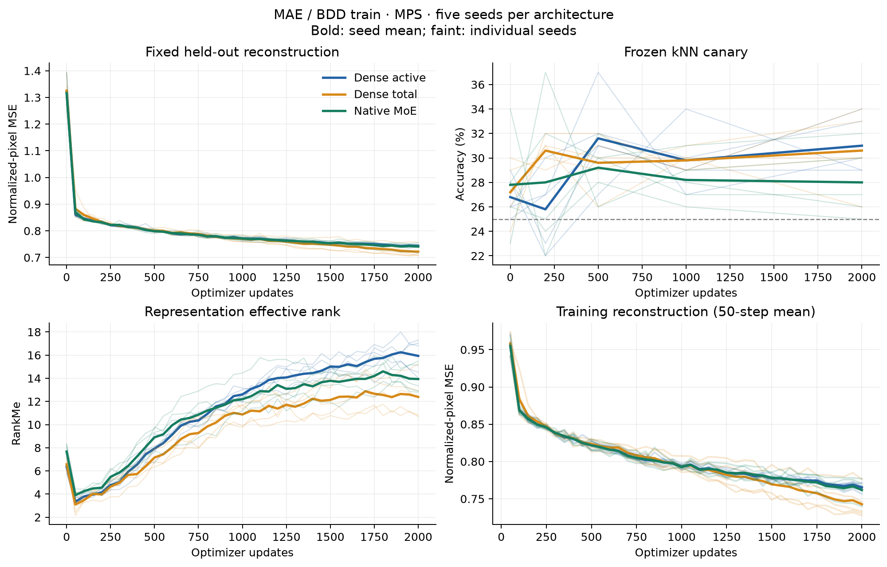
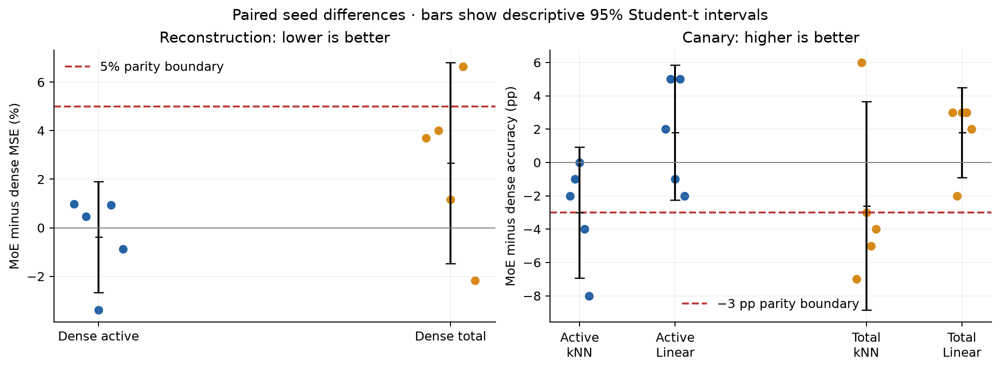
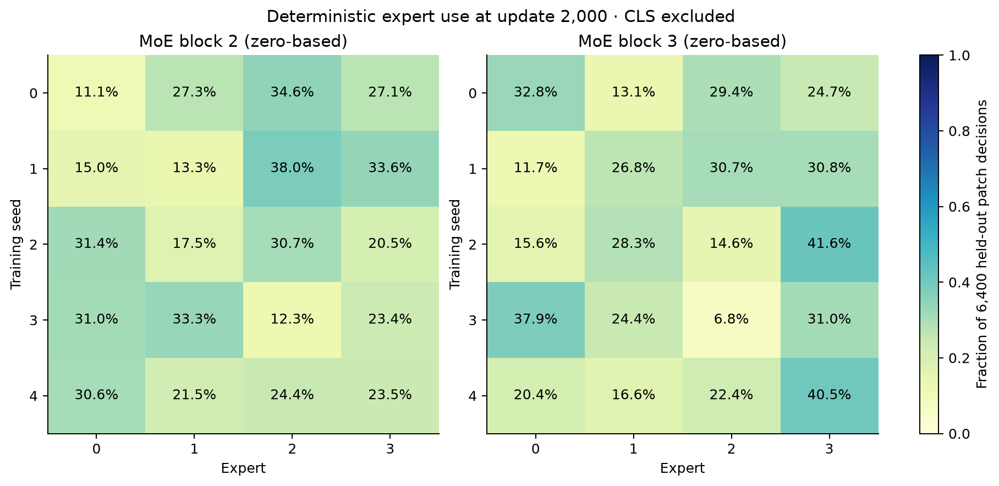
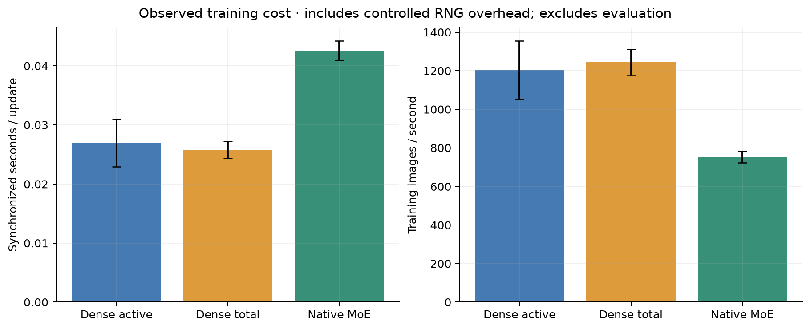

# WP-M0 MAE/BDD native warm-well results

All 15 primary runs completed 2,000 optimizer updates on MPS.

| Arm | Held-out MSE | kNN (%) | Linear (%) | RankMe | Train seconds | Images/s |
| -- | -: | -: | -: | -: | -: | -: |
| Dense active | 0.7437 ± 0.0037 | 31.0 ± 2.3 | 26.6 ± 5.1 | 15.93 ± 1.53 | 53.9 ± 8.0 | 1205 ± 151 |
| Dense total | 0.7221 ± 0.0204 | 30.6 ± 3.1 | 26.6 ± 2.4 | 12.39 ± 1.85 | 51.6 ± 2.9 | 1244 ± 68 |
| Native MoE | 0.7409 ± 0.0145 | 28.0 ± 2.9 | 28.4 ± 1.9 | 13.94 ± 1.28 | 85.2 ± 3.3 | 752 ± 30 |

Values are seed mean ± sample standard deviation. Pure held-out reconstruction is averaged over eight fixed
masks/augmentation draws per image.

## Paired comparison

| Dense reference | MoE MSE difference (%) | MoE kNN difference (pp) | MoE linear difference (pp) |
| -- | -: | -: | -: |
| Dense active | -0.37 [-2.66, +1.92] | -3.00 [-6.93, +0.93] | +1.80 [-2.26, +5.86] |
| Dense total | +2.67 [-1.47, +6.81] | -2.60 [-8.85, +3.65] | +1.80 [-0.89, +4.49] |

Intervals use five paired seed outcomes. Checkpoint rows and mask draws are not independent replicates.

The predefined practical boundaries are +5% reconstruction MSE and −3 percentage points canary accuracy. A mean within
the boundary is insufficient if its interval crosses the boundary.

- Against Dense active: MSE parity supported; kNN parity inconclusive; linear parity supported.
- Against Dense total: MSE parity inconclusive; kNN parity inconclusive; linear parity supported.

## Well selection and expert use

- Dense active: certified plateau steps by seed: [None, None, None, None, None]. A missing step is cap-limited, not
    proof of convergence.
- Dense total: certified plateau steps by seed: [None, None, None, None, 1900]. A missing step is cap-limited, not proof
    of convergence.
- Native MoE: certified plateau steps by seed: [None, 1850, None, 1950, None]. A missing step is cap-limited, not proof
    of convergence.
- Block 2: full-image dead experts [0.0, 0.0, 0.0, 0.0, 0.0]; masked-query dead experts [0.0, 0.0, 0.0, 0.0, 0.0];
    minimum full-image patch loads (%) [11.11, 13.28, 17.45, 12.27, 21.48]; mean expert-output CKA 0.4953.
- Block 3: full-image dead experts [0.0, 0.0, 0.0, 0.0, 0.0]; masked-query dead experts [0.0, 0.0, 0.0, 0.0, 0.0];
    minimum full-image patch loads (%) [13.06, 11.73, 14.58, 6.78, 16.61]; mean expert-output CKA 0.4110.
- Every expert received patch assignments in the final 200 training updates: True.

## Integration acceptance

- Dense active: Tier A True, Tier B True; certified plateau well used: False.
- Dense total: Tier A True, Tier B True; certified plateau well used: False.
- Native MoE: Tier A True, Tier B True; certified plateau well used: False.

The full training pool was used for each seed-0 accept-all integration walk, with a health read every 50 batches. These
loose sanity checks do not establish parity or forgetting protection.

## Protocol and limits

- BDD train: 61,555 usable images, four scenes, 18 regimes; fixed support/query sets have 100 images each. Training
    pool: 61,355.
- Actual image order hashes match across all three arms for each seed. Augmentation and masking hashes match at the
    first five and every 100th update.
- Native MoE uses four experts, top-1 token routing, blocks 2/3, batch balancing, and auxiliary coefficient 0.01. Dense
    total capacity differs by 0.25%.
- Training cost includes per-step RNG isolation and MoE router-noise isolation. It excludes evaluation and checkpoint
    writes. It is an observed experiment-run cost, not an optimized sparsity benchmark.
- MPS memory figures are sampled allocator/driver maxima, not continuous peaks; RSS is the process lifetime peak in a
    sequential ensemble, not an independent per-arm peak.
- EMA/bias balancing, upcycling, and JE cross-view consistency remain deferred. Routing measurements are candidate
    signals.
- Fixed-budget endpoint quality is distinct from certified warm-well convergence. Five seeds and 100 fixed query images
    provide limited precision.
- The training reference panel is sampled from the natural-frequency pool, while the query panel is scene-balanced.
    Their reconstruction gap is descriptive and can reflect composition differences; it is not a clean overfitting
    estimate.
- The deployment smoke uses an endpoint checkpoint when seed 0 has no certified plateau. Its Tier-A memory-flat check is
    not enabled; finite signals, channel completeness, and trust completeness are checked.









## Reproduce and inspect

The execution runner is [run_moe_warm_comparison.py](run_moe_warm_comparison.py); the analyzer is
[analyze_moe_warm_comparison.py](analyze_moe_warm_comparison.py). The [original plan](WP-M0-warm-well-mae-bdd-plan.md)
defines the experiment.

```bash
caffeinate -i .venv/bin/python docs/experiments/run_moe_warm_comparison.py --phase all
MPLCONFIGDIR=outputs/wp_m0_mae_bdd_mps_2026-10-07/analysis/.matplotlib .venv/bin/python docs/experiments/analyze_moe_warm_comparison.py --output outputs/wp_m0_mae_bdd_mps_2026-10-07
```

Raw measurements, full-method checkpoints every 50 updates, selected wells, data identities/cache, deployment corpora,
and code/runtime provenance are saved under `outputs/wp_m0_mae_bdd_mps_2026-10-07/`. A fresh run should use a new
`--output` directory; complete-run markers otherwise reuse results. Binary checkpoints and the large data cache are not
tracked by Git.

[Per-seed summary](artifacts/WP-M0-mae-bdd-native/seed_summary.csv) ·
[Paired statistics](artifacts/WP-M0-mae-bdd-native/comparison.json).
