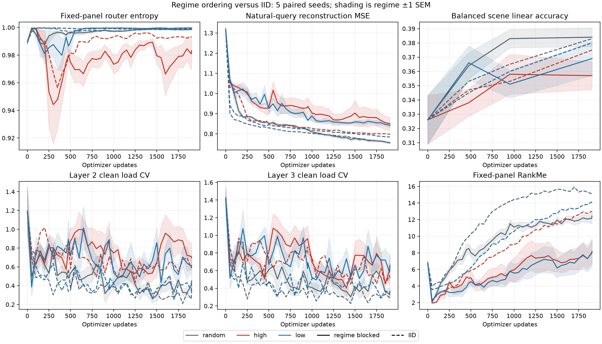
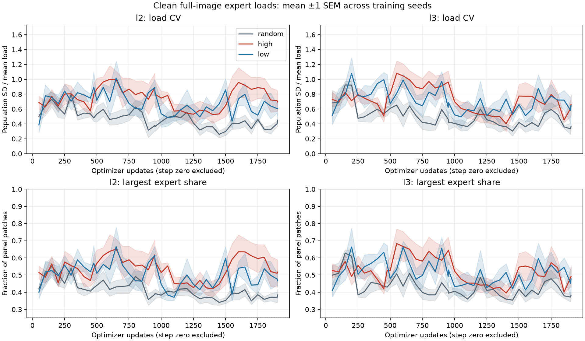

# WP-M0.2: regime-blocked BDD routing entropy filtering

## Motivation

This is a **WP-M0 subexperiment** that checks the selection vehicle under regime ordering; see the
[WP-M0 summary](../latest-results/WP-M0.md). It does not fulfill the planned WP-M1 specialization study or WP-M2
health-signal calibration.

Repeat [WP-M0.1](WP-M0.1.md) with images arriving in contiguous time-of-day × weather blocks. This isolates stream
ordering while retaining the same data, training recipe, admission rules, initialization seeds, and measurements. The
stream is a label-defined non-IID proxy over BDD still images. It preserves the original two-pass budget and does not
reconstruct video timestamps.

## Results

All 15 runs completed 1,904 updates each, totaling 28,560 measured updates. All planned seeds are retained. Initial
weights, features, token-entropy arrays and other saved initialization arrays match WP-M0.1 exactly. Actual candidate
logs match the frozen regime order and the shuffled control's retained image membership for every seed and epoch.

Values are seed mean ± sample SD. Router entropy is normalized by log(number of experts).

| Filter | Endpoint router entropy | Natural-query MSE | Balanced kNN (%) | Balanced linear (%) | RankMe |
| -- | -: | -: | -: | -: | -: |
| Random-half | 0.99855 ± 0.00088 | 0.7557 ± 0.0099 | 34.7 ± 2.4 | 38.4 ± 1.5 | 12.43 ± 1.27 |
| High-entropy-half | 0.98319 ± 0.02175 | 0.8504 ± 0.0706 | 34.6 ± 1.6 | 35.7 ± 2.2 | 8.15 ± 3.14 |
| Low-entropy-half | 0.99970 ± 0.00014 | 0.8418 ± 0.0243 | 33.2 ± 1.6 | 36.9 ± 2.7 | 8.03 ± 3.88 |

The primary contrasts compare each filter with random within the same seed. Brackets throughout this report are
descriptive 95% paired t intervals across five seeds, without multiplicity adjustment.

| Contrast | Entropy-change difference | Relative MSE difference (%) | kNN difference (pp) | Linear difference (pp) |
| -- | -: | -: | -: | -: |
| High minus random | −0.01536 [−0.04257, +0.01185] | +12.48 [+2.30, +22.66] | −0.10 [−3.96, +3.76] | −2.70 [−5.25, −0.15] |
| Low minus random | +0.00115 [−0.00003, +0.00233] | +11.39 [+8.93, +13.84] | −1.50 [−3.78, +0.78] | −1.50 [−4.17, +1.17] |

Both filters worsen reconstruction relative to random-half. Low entropy's entire interval exceeds the original 5%
practical reference boundary; high entropy's interval spans that boundary. High entropy has lower mean router entropy,
but its across-seed variation makes the paired endpoint entropy contrast uncertain. Low entropy finishes closest to
uniform probabilities. Thus selecting relatively confident candidates does not make the final router globally confident.

Neither filter improves scene probes. High entropy's linear accuracy is lower in the paired comparison. RankMe is lower
under both filters, indicating less distributed feature variation by this measure. That observation alone does not
establish representation collapse. Linear gains over each seed's frozen-random initialization are +5.8, +3.1 and +4.3
percentage points for random, high and low.

### What changed relative to shuffled BDD

These comparisons match each policy and seed across stream orders. They differ from the filter-versus-random contrasts
above.

| Policy | Regime minus shuffled relative MSE (%) | kNN change (pp) | Linear change (pp) |
| -- | -: | -: | -: |
| Random | −0.19 [−3.51, +3.14] | −2.10 [−6.90, +2.70] | +0.10 [−3.25, +3.45] |
| High entropy | +6.88 [−4.11, +17.87] | −2.50 [−4.08, −0.92] | −1.80 [−4.46, +0.86] |
| Low entropy | +7.33 [+4.16, +10.49] | −3.00 [−4.46, −1.54] | −1.10 [−6.50, +4.30] |

Random-half reaches essentially the same mean reconstruction error as its shuffled control. Low-entropy filtering has
higher reconstruction error under regime ordering. High entropy's corresponding order effect is less settled.

To test whether ordering changes a filter's disadvantage, subtract its shuffled relative penalty versus random from its
regime-stream penalty. The penalty widens by **7.75 percentage points [2.41, 13.10] for low entropy**. High entropy's
mean widening is 7.37 points [−5.66, +20.41], with an uncertain direction. These comparisons support a stream-order
sensitivity of low-entropy admission in this setting. They do not establish an effect shared by all possible regime
walks.



### Expert loads: layers 2 and 3

The [layer 2](artifacts/WP-M0.2/l2_expert_loads.png) and [layer 3](artifacts/WP-M0.2/l3_expert_loads.png) plots retain
per-seed expert identities. They count hard top-1 patch assignments on the same 200 clean full images: 12,800 patches
per layer, excluding CLS. The layer indices are zero-based encoder blocks. Equal allocation across four experts gives
25% each, load CV=0 and normalized histogram entropy=1. These statistics differ from the mean per-token probability
entropy used for selection.

| Layer | Filter | Endpoint largest share (%) | Endpoint CV | Endpoint load entropy | Trajectory-mean CV |
| -- | -- | -: | -: | -: | -: |
| 2 | Random | 38.4 ± 7.6 | 0.451 ± 0.190 | 0.907 ± 0.057 | 0.473 ± 0.045 |
| 2 | High entropy | 51.7 ± 14.4 | 0.695 ± 0.268 | 0.817 ± 0.123 | 0.751 ± 0.115 |
| 2 | Low entropy | 46.7 ± 8.5 | 0.608 ± 0.224 | 0.849 ± 0.098 | 0.686 ± 0.074 |
| 3 | Random | 38.2 ± 3.8 | 0.368 ± 0.063 | 0.951 ± 0.017 | 0.502 ± 0.053 |
| 3 | High entropy | 49.1 ± 14.3 | 0.661 ± 0.296 | 0.821 ± 0.136 | 0.726 ± 0.097 |
| 3 | Low entropy | 47.7 ± 15.4 | 0.647 ± 0.313 | 0.818 ± 0.174 | 0.721 ± 0.136 |

Largest-share and other scalar measures are computed within each seed before averaging. Expert IDs are not aligned
across seeds. Trajectory means integrate recorded evaluations from update 50 through 1,904, using trapezoidal
interpolation. They exclude initialization and do not observe loads continuously between checkpoints.

| Contrast | Layer 2 trajectory-mean CV difference | Layer 3 trajectory-mean CV difference |
| -- | -: | -: |
| High minus random | +0.278 [+0.165, +0.392] | +0.224 [+0.112, +0.336] |
| Low minus random | +0.213 [+0.160, +0.266] | +0.219 [+0.077, +0.361] |

Both filters increase clean-load concentration over the observed trajectory. This extends the shuffled finding: low
entropy's trajectory contrasts were uncertain in WP-M0.1. Mean trajectory CV also rises under regime ordering in every
policy/layer combination. For example, low entropy rises from 0.427/0.461 to 0.686/0.721 in layers 2/3. These latter
figures compare means; their uncertainty is not summarized by the within-regime contrast intervals above.

Transient concentration can be extreme. Low-entropy seed 4 assigns 97.1% of panel patches to one layer-2 expert and
99.98% to one layer-3 expert at update 476. High entropy's largest observed shares are 96.6% in layer 2 and 96.4% in
layer 3. Random's corresponding observed peaks are 75.0% and 71.7%. These are maxima at sampled evaluations, not
measured durations. At the endpoint all four experts receive panel patches. High entropy has an endpoint majority expert
in two seeds per layer; low entropy has two layer-2 and one layer-3 endpoint majorities; random has none.

Actual noisy masked training assignments remain much more balanced overall. Mean per-update training CVs are
0.109/0.132/0.129 in layer 2 and 0.109/0.154/0.134 in layer 3 for random/high/low. Pooled training CVs are
0.018/0.028/0.010 and 0.014/0.036/0.011. Pooling hides transient gaps: of 9,520 updates per policy, low entropy has 83
layer-2 and 38 layer-3 batches with at least one zero-patch expert. High entropy has 7 and 1; random has 0 and 1. These
are batch counts, not independent replicates or proof of expert death. Every expert receives patches in every one of
each run's final 200 training batches.

Training uses 512 visible patches per layer per update, with augmentation and router noise. The auxiliary loss also
includes CLS and regularizes soft importance and expected noisy load. Clean-panel imbalance therefore does not by itself
establish failure of balancing, semantic specialization, or persistent loss of expert learning. Its co-occurrence with
worse reconstruction does not establish causation.



### Selection and view sensitivity

Large regimes have almost exactly half their exposures admitted under every policy. For example, pooled daytime-clear
and night-clear admission are approximately 50% in all arms. Rare boundary regimes can differ: daytime-foggy has just
470 candidate exposures across all seed/epoch combinations, with 50.6%/59.4%/39.1% admitted by random/high/low. The
[joint-regime table](artifacts/WP-M0.2/regime_acceptance.csv) retains every regime separately. This constrains the
interpretation: the reconstruction penalty remains even when selection cannot substantially change the large regimes'
relative frequencies. Within-regime selection and its interaction with model adaptation remain coupled.

Unique training-image coverage after two passes is 75.0%, 70.4% and 71.6% for random/high/low. Full-image versus
four-mask-average entropy rank correlations are 0.904, 0.922 and 0.890, with selected-half overlaps of 86.9%, 91.3% and
86.9%. This is the same mask-only sensitivity check as WP-M0.1; it does not isolate augmentation or router noise.
Component timings are retained, but host pauses during this run make wall-clock efficiency comparisons inappropriate.

## Protocol

| Factor | Matched setting |
| -- | -- |
| Data | Same verified 61,555-image BDD cache, four retained scenes and defined driving attributes |
| Splits | Identical 60,955 training IDs and disjoint 200-image support, balanced-query and natural-query panels |
| Model | Native MoE-MAE, 64 px, patch size 8, width 96, depth 4, four experts in zero-based blocks 2/3, dense decoder |
| Gate | Full softmax before top-1, selected probability retained without renormalization |
| Objective | MAE masking ratio 0.75, normalized pixel targets, balancing auxiliary coefficient 0.01 |
| Filters | Random-half, highest-entropy-half, lowest-entropy-half; clean full-image scoring excluding CLS |
| Budget | Two epochs, 952 updates per epoch, 1,904 updates per run; candidate batch 64, accepted batch 32 |
| Optimizer | AdamW, LR 0.001, weight decay 0.05, gradient clip 1.0, constant LR with no boundary restart |
| Randomness | Paired seeds 0–4, identical initial weights, image/epoch-keyed augmentation and masks |
| Evaluation | Same cadence and fixed panels; four reconstruction-mask draws, identical kNN/linear probe recipes |
| Runtime | CPU with four threads; Torch 2.13.0 and Python 3.12.13, matching WP-M0.1 |

The sole experimental change is `stream_order=regime_blocked`. The inherited configuration also selects a fresh output
directory, preserving all WP-M0.1 results.

### Regime walk and batch boundaries

Each epoch follows the source's fixed 18-regime walk:

1. **Daytime:** clear → partly cloudy → overcast → rainy → snowy → foggy.
1. **Dawn/dusk:** the same weather sequence.
1. **Night:** the same weather sequence.

The second epoch repeats that walk with a fresh shuffle within each block. Regime frequencies are their natural
frequencies in the retained candidate pool; blocks are not equalized or resampled. Labels determine arrival order only.
They do not enter the selector or MAE loss.

To match candidate exposure exactly, first reconstruct the WP-M0.1 seed/epoch permutation and retain its first 60,928
images. Stably group that retained prefix by regime, preserving its random relative order within each block. The same 27
excluded IDs remain excluded in both conditions. This protects small regimes from being lost merely because they occur
near the end of the walk.

Concatenate the blocks and cut fixed batches of 64. There are 16–17 boundary-straddling batches out of 952 per epoch;
over 98% of batches contain one regime only. Short regimes remain in the stream without padding or duplication.
`stream_manifest.json` records exact regime spans, fractional update boundaries, mixed-batch indices, order hashes,
retained-membership hashes, and excluded IDs for all five seeds and both epochs.

Exact half-batch admission constrains the acceptance rate of large pure-regime blocks to approximately 50%, regardless
of the ranking rule. The filters can change which images are learned within a regime; they have much less freedom to
rebalance time/weather frequencies than in WP-M0.1. Very short regimes inside mixed boundary batches can deviate from
50%. Scene composition can still vary within a driving regime.

### Outcomes and comparison

Retain WP-M0.1's primary endpoint definitions: fixed-panel mean normalized router-entropy change from initialization and
natural-query reconstruction MSE. Compare high-minus-random and low-minus-random within the blocked stream. Retain scene
probes, representation-health channels, masked/full routing sensitivity, clean expert loads, actual noisy masked
training assignments, selection audits, and component timing.

Also compare each blocked arm against its matching shuffled arm within seed. The order-comparison report separates that
effect from the change in each filter's relative reconstruction penalty versus random. Intervals are descriptive 95%
paired t intervals across five training seeds; they are not multiplicity-adjusted significance tests.

Global quality or load changes alone do not establish past-regime forgetting. This repeat uses the same evaluation
protocol and does not add a per-era forgetting matrix, controller, replay, or new training intervention.

All seeds share one fixed regime walk. Differences therefore describe this ordering, including its final night/foggy
block, rather than averaging over possible regime schedules. Small input resolution, the short two-epoch horizon and the
fixed evaluation panels retain WP-M0.1's limits.

## Engineering validation

The preflight check verifies that configuration values other than ordering/output, software versions, all data-panel
memberships, and all five initial encoder/decoder hashes match WP-M0.1. Model, SSL, metric and selector source hashes
are unchanged. Runner changes implement ordering and its audit trail.

Tests cover stable regime grouping, identical retained/excluded IDs, small-block retention, even batch budgets, shared
three-arm candidate order, matched image augmentations/masks, and exact CPU checkpoint continuation across regime
boundaries and epoch resets. The analysis also checks candidate membership against WP-M0.1's saved selection logs before
comparing order effects.

Validation: 389 unit tests passed with 89.47% coverage; one MPS test was skipped because that device was unavailable.
The strengthened saved-trace and regime-admission integration check also passes. CPU continuation is exact across regime
boundaries and epoch resets. Frozen training source hashes match the completed run.

## Artifacts and reproduction

Promoted artifacts use `artifacts/WP-M0.2/` and the `WP-M0.2` experiment identifier. Archived raw outputs and frozen
provenance retain their recorded paths and contents.

```bash
UV_CACHE_DIR=/private/tmp/cafl4ds-routing-uv uv run --no-sync python scripts/run_routing_experiment.py --config-name routing_regime_experiment
UV_CACHE_DIR=/private/tmp/cafl4ds-routing-uv uv run --no-sync python scripts/analyze_routing_experiment.py --output outputs/moe_routing_entropy_regime_2026-10-27 --compare-with outputs/moe_routing_entropy_2026-10-19
```

Configuration: [`routing_regime_experiment.yaml`](../../../cafl4ds/configs/routing_regime_experiment.yaml). The
inherited base config supplies the complete WP-M0.1 recipe. Ordering is implemented in
[`routing_streams.py`](../../../cafl4ds/routing_streams.py); matched condition comparisons are implemented in
[`routing_order_analysis.py`](../../../cafl4ds/routing_order_analysis.py).

Raw outputs are under `outputs/moe_routing_entropy_regime_2026-10-27/`, using the same per-seed/per-arm format as
WP-M0.1. Additional files are `reference_check.json`, its reproducible `check_reference.py`, and `stream_manifest.json`.
The frozen protocol hash is `97fbc8f23546ca7eec91acc28b9832ad4ff1623f4ec7b950533750603ef08cd1`.

The analyzer writes the same performance, entropy, selection and load statistics as WP-M0.1, plus
`analysis/order_comparison.json`, `order_comparison.csv`, `order_comparison.md`, `order_comparison.png` and
`stream_timeline.png`, plus joint-regime `regime_acceptance.csv`. Original shuffled results are read as the reference
and are not overwritten.

Promoted artifacts are under [`artifacts/WP-M0.2/`](artifacts/WP-M0.2/). `comparison.json` contains seed-level aggregate
statistics, paired contrasts, load statistics, matched order effects and verification; it omits raw arrays and training
traces. `protocol_summary.json` keeps the frozen configuration, source hashes and panel counts. `reference_check.json`
and `stream_manifest.json` retain the matching controls and exact stream schedule. CSVs contain seed endpoints,
attribute/regime admission and layer-load summaries. Figures include learning curves, selection entropy and composition,
per-seed expert loads, load concentration, the regime timeline and matched stream-order trajectories. Checkpoints, image
IDs, token arrays and full logs remain in the raw output directory.
