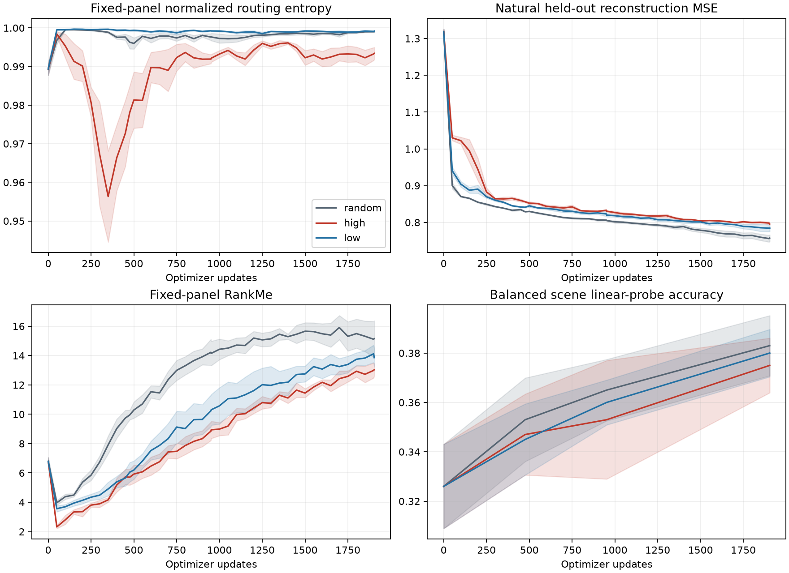
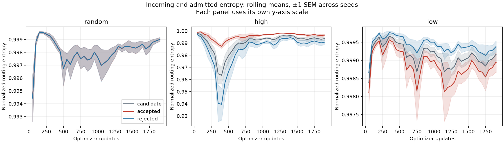
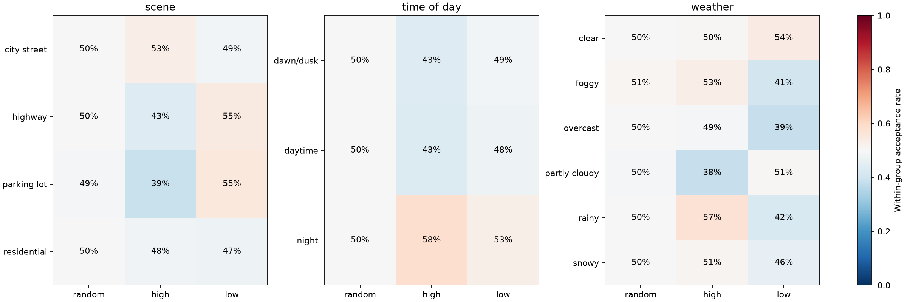

# WP-M1: routing entropy filtering during MoE-MAE training

## Motivation

The selector changes the images the model learns from, and the adapting model changes future selection scores. This
stationary BDD reference measures how that feedback affects routing and representation quality. It addresses the
project's self-reinforcing selection question without assuming that high or low routing entropy is healthier.

This study does not establish forgetting, a health-control benefit, or the correlated-stream Phase-1 exit gate.

## Results

All 15 measured runs completed their fixed budget, totaling 28,560 optimizer updates. Initial method weights,
candidate-order hashes, initial fixed-panel features and initial token entropy match across the three arms within every
seed. All five planned seeds are retained.

Values below are seed mean ± sample standard deviation. Entropy is normalized to [0, 1].

| Filter | Endpoint routing entropy | Natural-query MSE | Balanced kNN (%) | Balanced linear (%) |
| -- | -: | -: | -: | -: |
| Random-half | 0.99903 ± 0.00037 | 0.7575 ± 0.0203 | 36.8 ± 1.6 | 38.3 ± 2.7 |
| High-entropy-half | 0.99342 ± 0.00349 | 0.7956 ± 0.0026 | 37.1 ± 1.4 | 37.5 ± 2.5 |
| Low-entropy-half | 0.99916 ± 0.00043 | 0.7845 ± 0.0197 | 36.2 ± 1.8 | 38.0 ± 2.2 |

The planned contrasts use the within-seed difference in entropy change from initialization, and the relative difference
in endpoint natural-query MSE. Brackets are descriptive 95% paired t intervals across five training seeds.

| Contrast | Entropy-change difference | Relative MSE difference (%) | kNN difference (pp) | Linear difference (pp) |
| -- | -: | -: | -: | -: |
| High minus random | −0.00561 [−0.00992, −0.00130] | +5.10 [+1.55, +8.66] | +0.30 [−3.00, +3.60] | −0.80 [−3.38, +1.78] |
| Low minus random | +0.00012 [−0.00071, +0.00095] | +3.63 [−1.35, +8.62] | −0.60 [−4.75, +3.55] | −0.30 [−5.86, +5.26] |

High-entropy admission changes the routing trajectory, with a pronounced early entropy dip followed by recovery. Its
endpoint entropy remains slightly below random-half, but all arms finish near the uniform-router entropy ceiling. All
three arms have higher mean endpoint entropy than at initialization. Selecting the relatively lowest-entropy half
therefore does not imply globally confident routing.

High-entropy admission also has higher held-out reconstruction error. Its mean relative increase is just above the 5%
practical reference boundary, but the interval spans values on either side of that boundary. The low-entropy
reconstruction contrast is uncertain. Neither filter has a clear scene-probe advantage. Mean linear-probe gains over the
frozen-random B5 are +5.7, +4.9 and +5.4 percentage points for random, high and low respectively; these descriptive
gains do not establish the correlated-stream adaptation gate.

The two entropy policies change the training diet. High-entropy admission accepts about 58% of nighttime candidate
exposures but 43% of daytime exposures, compared with about 50% for random. It accepts about 57% of rainy exposures and
38% of partly cloudy exposures. Low-entropy admission accepts about 55% of highway exposures and 39% of overcast
exposures. These are post-decision attribute audits, not label-based selection. The policies' diets are not required to
remain complementary after their models diverge.

At the endpoint every expert receives patch assignments on the fixed reference panel and in the last 200 training
updates. Earlier full-image loads show temporary concentration, especially under high-entropy selection. RankMe is lower
under entropy filtering than random at the endpoint, but that movement alone does not establish collapse or
representation damage. Scene-probe uncertainty and the trust annotations remain relevant to that interpretation.

The mean full-versus-four-mask-average rank correlations are 0.875, 0.965 and 0.911 for random, high and low. The
corresponding selected-half overlaps are 88.1%, 95.0% and 87.5%. This supports full-image scoring as a useful reference
for this mask-only sensitivity check; it does not certify agreement under augmentation or router noise. Endpoint
entropy/error rank correlations vary across seeds and are weak on average, so routing entropy is not established as a
reconstruction-difficulty score.

Each run spends about 38 seconds on scoring and 54 seconds on updates, plus about six seconds preparing views and 31
seconds on evaluation. These are observed instrumented CPU-run costs, excluding checkpoint/logging costs from those
component timers. A deployable random selector would omit scoring. Unique training-image coverage after two epochs is
75.0%, 73.1% and 72.4% respectively; acceptance exposures and unique-image coverage are distinct budgets.

Intervals condition on one fixed data/evaluation split and describe training-seed variation. They do not quantify
variation over possible evaluation panels. Five seeds, small images and a short horizon limit the conclusion. A
frozen-scoring ablation is still needed to isolate feedback from a different fixed data diet.







## Method

Three exact half-batch admission rules use the current pre-update model: uniform random selection, highest routing
entropy, and lowest routing entropy. Entropy is computed over all experts before top-k, excluding CLS, then averaged
over MoE layers and patch tokens. Full-image scoring is deterministic; masked-view sensitivity is checked separately.

The top-1 gate retains the selected expert's full-softmax probability as its output weight, without renormalization.
Reconstruction therefore trains the router. Batch importance/load balancing remains active with auxiliary coefficient
0.01. The earlier WP-M0 selected-only-softmax gate had different semantics; its numbers are not a matched control.

Each arm starts from the same random encoder and decoder within each seed. Seeds 0–4 are independent training
replicates. The architecture uses 64 px images, patch size 8, width 96, depth 4, four experts in encoder blocks 2/3, a
dense decoder, and MAE masking ratio 0.75. All arms use AdamW at learning rate 0.001, weight decay 0.05, gradient clip
1.0, and a constant learning rate.

Each of two epochs reshuffles 60,955 training images. Candidate batches contain 64 images and update batches contain 32
accepted images. Each complete epoch has 952 updates and drops 27 trailing candidates. Thus each run makes 1,904
updates, scores 121,856 candidate exposures, and trains on 60,928 accepted exposures. An image rejected in one epoch can
be admitted in the next. The primary device is CPU with four threads, selected by throughput before measured runs.

The source is the verified WP-M0 BDD train cache: 61,555 usable images with defined scene, weather and time-of-day
attributes, retaining four scenes with at least 100 images. These restrictions are shared across arms. The pool is not
the nominal full 100,000-image dataset. Reserve 50 support and 50 query images per scene, plus 200 independent
natural-frequency query images, using split seed 1729. All three panels are excluded from training.

Reference routing and reconstruction are measured every 50 updates and at initialization, quarter, half and endpoint.
Reconstruction averages four fixed per-image mask/augmentation draws. Scene kNN and standardized linear probes use the
same support images at initialization, quarter, half and endpoint, on both balanced and natural query panels. Each
seed's initial measurements are its frozen-random B5 reference. Geometry and drift retain the project's trust tags;
neither routing entropy nor drift alone establishes damage.

The primary routing outcome is endpoint fixed-panel mean normalized entropy minus its initialization value. The primary
learning outcome is natural-query reconstruction MSE. Planned contrasts are high-minus-random and low-minus-random
within seed. Descriptive 95% paired t intervals use seeds as replicates. Tokens, mask draws, images and checkpoint rows
do not increase that replicate count. Practical reference boundaries are 0.02 normalized entropy, 5% relative MSE and
three percentage points of probe accuracy; these are not equivalence certificates or multiplicity-adjusted hypothesis
tests.

## Engineering validation

The requested gate passes direct weighted-expert forward checks and a masked-reconstruction-only router-gradient test
with balancing disabled. Scientific invariants cover entropy reduction, CLS exclusion, expert permutation, selection
direction and count, random ties, read-only scoring, train/query separation, and image-keyed augmentation and masks
across policies. Exact interrupted-versus-uninterrupted continuation is checked on CPU and MPS.

The seed-0 200-update BDD pilot is an engineering run, excluded from the comparison. Throughput trials compare CPU
thread counts and MPS batch sizes without selecting a budget from scientific outcomes. The measured protocol uses the
original batch size 64 and two complete epochs. Initial weights and complete candidate-order hashes are verified across
all three arms for every measured seed.

## Artifacts and reproduction

The [design](../moe-routing-entropy-filtering-plan.md) records decisions and interpretive limits. The runner is
[`scripts/run_routing_experiment.py`](../../../scripts/run_routing_experiment.py), with business logic in
[`cafl4ds/routing_experiment.py`](../../../cafl4ds/routing_experiment.py) and configuration in
[`routing_experiment.yaml`](../../../cafl4ds/configs/routing_experiment.yaml).

```bash
UV_CACHE_DIR=/private/tmp/cafl4ds-routing-uv uv run --no-sync python scripts/run_routing_experiment.py
UV_CACHE_DIR=/private/tmp/cafl4ds-routing-uv uv run --no-sync python scripts/analyze_routing_experiment.py
```

The default source requires the existing verified cache at `outputs/wp_m0_mae_bdd_mps_2026-10-07/data/`. Override
`source.directory` for another cache in that identity-preserving format. Use `device=mps` for local GPU execution when
available. Synthetic wiring can be exercised with `routing_source@source=synthetic`, smaller image/model overrides, and
suitable panel sizes. Synthetic runs are never scientific BDD results.

Measured outputs live under `outputs/moe_routing_entropy_2026-10-19/`: resolved config, frozen protocol, membership and
source hashes, source snapshots, trust annotations, per-seed/per-arm selection/training/evaluation records, fixed-panel
token maps and features, initial/quarter/half/endpoint states, resumable latest checkpoints, and `comparison.json`. The
analyzer adds seed summaries, paired effects, attribute acceptance rates, entropy trajectories, gate diagnostics, and
per-seed expert-load plots under `analysis/`. Expert identities are never averaged across independent seeds. Checkpoints
include method, optimizer, admission RNG, route references, accepted-image coverage and durable log offsets. An
interrupted command resumes the same frozen protocol; changed data/config/code requires a fresh `output` directory.

Pilot outputs are in `outputs/moe_routing_entropy_pilot_2026-10-19/`; resource trials are in
`outputs/moe_routing_throughput_2026-10-19/` and `outputs/moe_routing_cpu_throughput_2026-10-19/`.

The tracked, compact artifact set is in [`artifacts/WP-M1/`](artifacts/WP-M1/):

- [`comparison.json`](artifacts/WP-M1/comparison.json): seed means/SDs, paired effects, pairing checks and raw-run
    pointer.
- [`protocol_summary.json`](artifacts/WP-M1/protocol_summary.json): frozen configuration, source/data hashes, panel
    counts and engineering validation. Full per-image membership remains in the raw output.
- [`seed_summary.csv`](artifacts/WP-M1/seed_summary.csv): one row per training seed and filter, including B5 gains,
    routing, performance, mask sensitivity, accepted-image coverage and component timings.
- [`acceptance_rates.csv`](artifacts/WP-M1/acceptance_rates.csv): per-seed scene/weather/time acceptance counts and
    rates.
- Learning, selection-entropy, selection-bias and gate-diagnostic figures, plus per-seed expert-load figures for
    [block 2](artifacts/WP-M1/l2_expert_loads.png) and [block 3](artifacts/WP-M1/l3_expert_loads.png).

## Interpretation limits

The result is conditional on a small from-scratch model, 64 px images, two epochs, four retained scenes, and five
training seeds. Full-image clean routing and noisy visible-token training routing are distinct measurements. The gate
also scales expert outputs by probability, so confidence-dependent update strength is recorded alongside the data diet.
Resource times include research instrumentation; a deployable random selector would skip the scoring pass.

The mask-sensitivity check holds the image view fixed and changes only its patch mask. It does not measure crop/flip
agreement or the effect of training router noise. Acceptance rates in rare weather groups are descriptive; their
candidate counts remain available in the audit table.

Router entropy and hard expert-load entropy answer different questions. Nearly uniform soft probabilities may still have
strongly concentrated deterministic argmax assignments. Expert starvation is read separately on fixed full-image panels
and rolling noisy masked-training counts. RSS is a sequential-process lifetime peak, not a per-arm peak.

Load/count diagnostics exclude CLS. An inactive expert has zero patch assignments on the specified panel or window; this
is not proof that it received no training gradients.

Further work should test a frozen scoring copy, then blocked scene/attribute streams with fixed past-era evaluations.
Neither a routing change nor an IID accuracy change establishes forgetting or proves a co-adaptation mechanism.
